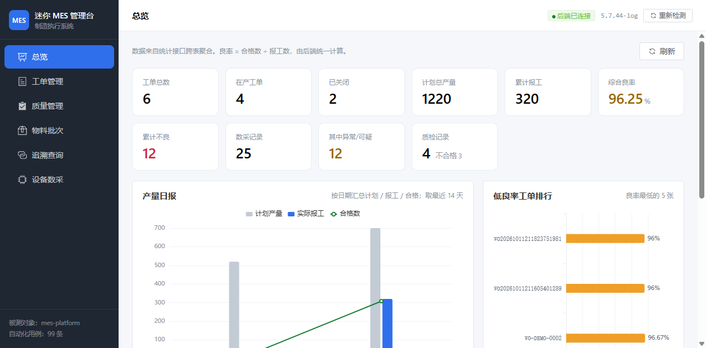
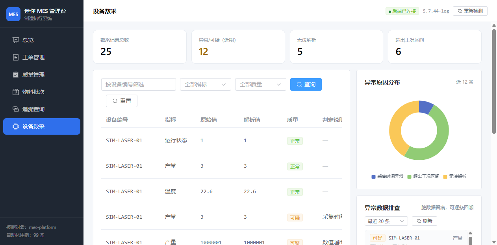

# MES 管理台（mes-console）

> MES 自动化测试平台项目的 **M4 交付物之二**。Vue 3 管理界面，将后端 24 个接口组织为可视化操作入口。

## 工程定位

项目前三阶段产出的成果以接口、脚本与报告的形式存在，主要面向开发与测试使用。本工程补充的是面向业务角色的操作界面：工单员建单与派工、质检员录入检验结果、仓管管理物料批次、运维查看设备数据。

界面同时承担对外演示的职责。访问者无需阅读代码或接口文档，通过实际点击即可观察系统的运行状态与数据流转，这比接口清单更能反映系统的完整程度。

---

## 1. 启动方式

前置条件：MES 后端已启动。界面自身不包含数据。

```bash
# 1. 启动后端（独立终端）
cd ../mes-platform
export JAVA_HOME="<JDK 17 路径>"
mvn spring-boot:run

# 2. 安装依赖并启动界面
cd ../mes-console
npm install
npm run dev
```

`npm run dev` 启动后监听 `http://localhost:5173`。

> 上面每行命令都请**单独执行**，不要把命令与其后的说明文字一起复制到别处。
> 在 IDE 的运行配置里，「实参」（Arguments）一栏必须**留空** ——
> 若把说明文字填进去，vite 会把它当作根目录参数，导致浏览器打开是 404（详见 `docs/使用手册.md` 第五节）。

生产构建与产物预览（产物输出至 `dist/`；预览监听 4173）：

```bash
npm run build
npm run preview
```

后端地址默认为 `http://127.0.0.1:8080`，切换环境时通过环境变量覆盖，无需修改代码：

```bash
MES_BASE_URL=http://192.168.1.10:8080 npm run dev
```

---

## 2. 页面构成

| 页面 | 对应接口 | 功能 |
|------|----------|------|
| 总览 | 统计接口 3 个 + 异常数采 | 核心指标卡、产量日报图、低良率工单排行、异常数采清单 |
| 工单管理 | 工单操作 7 个 | 建单、派工、报工、关闭；详情抽屉展示报工明细 |
| 质量管理 | 质检操作 5 个 | 质检录入、不良代码分布、按工单查询不良明细 |
| 物料批次 | 批次操作 6 个 | 批次建档、绑定工单、出货消耗 |
| 追溯查询 | 追溯接口 2 个 | 正向追溯（批次至流向）与反向追溯（工单至用料与不良），以时间线呈现链路 |
| 设备数采 | 数采操作 4 个 | 数采记录查询、异常原因分布、异常数据逐条排查 |

### 界面预览

以下截图取自实际运行的界面，数据来自真实接口。

**总览**：核心指标、产量日报与低良率排行



**设备数采**：表格中为 Modbus 模拟器上报的数据，含异常原因分布与逐条排查清单



其余页面截图见 [`docs/screenshots/`](./docs/screenshots)：
[工单管理](./docs/screenshots/02-工单管理.png) ·
[质量管理](./docs/screenshots/03-质量管理.png) ·
[物料批次](./docs/screenshots/04-物料批次.png) ·
[追溯查询](./docs/screenshots/05-追溯查询.png)

---

## 3. 设计取舍

**可用操作随状态变化，而非全部呈现后由后端拒绝。** 后端必须拦截非法状态流转，这是数据正确性的底线。但界面上不应将必然失败的操作呈现给使用者。工单进入已关闭状态后，报工按钮不再出现；批次进入已消耗状态后，绑定与出货操作同时消失。界面负责引导操作者执行合法动作，后端负责拦截越界请求，职责边界清晰。

**业务规则前置到界面，而非仅在提交失败时提示。** 质检录入过程中，填写数量后即时显示系统将推导出的结论及推导依据；报工过程中实时校验合格数与不良数之和是否等于报工数。操作者在提交前即可确认数据是否符合规则，避免了反复试错的成本。

**状态与文案的映射集中维护。** `NEW`、`DISPATCHED` 等英文状态码在列表、详情、标签与筛选项中反复出现。若各处分别维护中文映射，修改时容易遗漏，最终表现为同一状态在不同位置显示不同名称。这些映射统一收敛到 `src/utils/dict.js`，作为唯一来源。

---

## 4. 工程结构

```
mes-console/
├── vite.config.js         # 开发与预览的 /api 代理、构建分包配置
├── index.html
└── src/
    ├── main.js            # 应用挂载，注册 Element Plus 中文语言包
    ├── App.vue            # 布局：侧边导航与顶部连通状态指示
    ├── api/index.js       # 接口封装：统一契约、traceId 透传、错误转异常
    ├── utils/dict.js      # 状态字典与格式化函数，唯一来源
    ├── components/
    │   └── EChart.vue     # ECharts 包装：初始化、更新、尺寸自适应
    ├── styles/global.css
    └── views/             # 六个页面
        ├── Overview.vue
        ├── WorkOrders.vue
        ├── Quality.vue
        ├── Material.vue
        ├── Trace.vue
        └── Device.vue
```

---

## 5. 实现要点

**接口封装的统一处理。** MES 的响应约定为 HTTP 200 配合 `code` 字段承载业务结果。`src/api/index.js` 对这一约定做集中处理：`code != 0` 统一抛出异常并携带业务码与 traceId，页面只需区分成功与失败两种分支，不必在各处重复解析响应结构。traceId 随异常一并抛出，出现问题时可凭此定位到服务端日志。

**请求使用相对路径。** 开发与预览环境通过 Vite 的代理转发 `/api` 请求至后端。这样处理后端无需为前端单独配置跨域策略，环境切换也只需调整代理目标，前端代码保持不变。

**构建产物分包。** Vue、Element Plus 与 ECharts 三个依赖体积较大且极少变动，构建时拆分为独立 chunk。业务代码单独打包后约 71KB，修改业务逻辑不会导致访问者重新下载体积达 2MB 的三方库。

**图表组件的自适应处理。** `EChart.vue` 对 ECharts 做了轻量包装，使用 ResizeObserver 监听容器尺寸变化，侧边栏折叠或窗口缩放时图表同步重绘。筛选项变化时以整体替换方式更新配置，避免上一次查询的系列残留。

---

## 6. 已知边界

- 未实现登录与角色权限，界面为开放访问（与后端的授权现状一致）
- 未做国际化，界面语言为中文
- 表格未启用虚拟滚动，数据量达到数千行以上时列表渲染会变慢，当前数据规模不受影响
- 未做移动端适配。管理台以桌面场景为主，仅在宽度小于 992px 时做了基础换行处理
